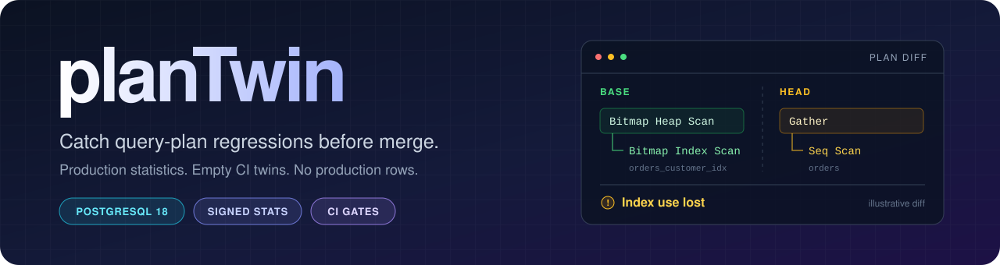
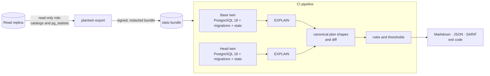

<p align="center">
  
</p>

<p align="center">
  <a href="https://github.com/raunaksahahere/planTwin/actions/workflows/ci.yml"></a>
  <a href="https://github.com/raunaksahahere/planTwin/releases/tag/v1.0.0"></a>
  
  <a href="LICENSE"></a>
  <a href="ext/plantwin/LICENSE"></a>
</p>

<p align="center">
  <a href="#quick-start"><b>Quickstart</b></a> ·
  <a href="#how-it-works"><b>How it works</b></a> ·
  <a href="#using-plantwin"><b>Commands</b></a> ·
  <a href="#evidence"><b>Evidence</b></a> ·
  <a href="#privacy"><b>Privacy</b></a> ·
  <a href="#documentation"><b>Documentation</b></a>
</p>

---

**Catch PostgreSQL query-plan regressions in pull requests, using production planner statistics and no production rows.**

PlanTwin shows how a migration or query change alters the plans PostgreSQL would choose in production, before the change is merged. It runs in CI against an empty PostgreSQL 18 database that has been given production's statistics, so the planner reasons about production-sized tables without any production data leaving the replica.

> [!NOTE]
> **Status: v1.0.0 released.** From 1.0.0, the CLI flags, exit codes, configuration keys and the JSON report's `schema_version` 1 stay compatible within 1.x. See [docs/COMPATIBILITY.md](docs/COMPATIBILITY.md) for the promise and what it excludes, and [docs/STATUS.md](docs/STATUS.md) for the release gates, what has run, and what has not been verified (for example, a real production replica).

## Why

A migration can pass every test in CI and still turn an index scan into a sequential scan in production. The cause is that CI databases are empty or small, so the planner chooses differently there. Existing options each have a cost: clone-based testing needs production data, and migration linters check DDL safety but not plan behaviour.

PlanTwin takes a different route. It exports the statistics that the planner uses (table sizes, column distributions, most common values) from a read replica, applies them to an empty database, and compares the plans before and after a change.

## How it works



1. **Export** runs on a read replica with a role that cannot read table rows. It runs in a read-only session with server-side timeouts, and writes a redacted, signed statistics bundle.
2. **Twin** is a throwaway PostgreSQL 18 container. Migrations are applied, the statistics are imported, and a small extension (loaded only in CI) makes the planner use the imported sizes.
3. **Compare** explains each query in a catalog on both twins, reduces each plan to its shape (operators, relations, indexes, join order), diffs the shapes, and applies rules with documented thresholds.

Full design: [docs/ARCHITECTURE.md](docs/ARCHITECTURE.md).

## Quick start

Requirements: Docker, Git, and `make`. Go is not required; it runs in a pinned container. Prebuilt CLI binaries for Linux and macOS (amd64 and arm64) are on the [releases page](https://github.com/raunaksahahere/planTwin/releases).

```bash
make image            # build the twin image plantwin-postgres:18 (includes the extension)
make build            # build bin/plantwin
./bin/plantwin demo   # synthetic production, a migration that drops an index, and the report
```

The demo creates its own repository, database and signing key in a temporary directory, and removes them afterwards. On a clean GitHub-hosted runner, the same commands produce a first report in 65 seconds; the timings and run are in [docs/quickstart-verification.md](docs/quickstart-verification.md).

To use PlanTwin on your own repository, see [docs/USAGE.md](docs/USAGE.md). In short:

```bash
plantwin init                                   # detect the migration tool, write plantwin.yaml
plantwin keygen --priv plantwin.key --pub plantwin.pub
PLANTWIN_DSN=postgres://plantwin_export:…@replica/app \
  plantwin export --sign-key plantwin.key       # on a read replica, with the restricted role
plantwin check --base main --head HEAD          # in CI or locally
```

## Using PlanTwin

| Command | Purpose |
|---|---|
| `plantwin init` | Detects the migration tool (plain SQL, Flyway, Django, Rails, Prisma, Alembic, Atlas) and writes `plantwin.yaml`. |
| `plantwin export` | Reads statistics from a replica, applies redaction, writes a signed bundle. |
| `plantwin keygen` | Creates an ed25519 key pair for signing bundles. |
| `plantwin check` | Compares base and head revisions and reports plan changes. |
| `plantwin explain <query>` | Shows both plan trees for one query from the last check. |
| `plantwin accept <query> <rule> [relation]` | Records an accepted finding in `.plantwin/accepted.json`. |
| `plantwin doctor` | Checks Docker, the image, the bundle, its signature and age, and the configuration. |
| `plantwin demo` | Runs the built-in example end to end. |
| `plantwin version` | Prints the version. |

Exit codes: `0` passed, `1` findings met `fail_on`, `2` usage or configuration error, `3` Docker or Git unavailable.

Unknown keys in `plantwin.yaml` are an error that names the line, so a misspelled key cannot be silently ignored. `plantwin check --timeout` (default `30m`) stops a run that does not finish.

Output formats for `check`: `--format md` (PR comment, default), `json` (with `schema_version`), or `sarif` (2.1.0, for code-scanning). Full flag reference and CI examples: [docs/USAGE.md](docs/USAGE.md).

## Example output

Real output of `plantwin demo`, from the fresh-clone check:

```markdown
## PlanTwin: HEAD~1 → HEAD

**Result: failing.** 1 error(s), 0 warning(s), 1 info.

> **Estimated:** statistics for orders were estimated, not imported. Findings on them are labelled.

### `customer_lookup`

- **ERROR** `lost_index` *(estimated)*: Index use lost on orders: a selective index is now unused, and the table is read by a sequential scan (about 500K rows).
  - Why this matters: Queries on this table used a selective index. Without it, PostgreSQL reads every row of the table.
  - Suggested fix: Recreate the index, or add it back in this migration. To accept the change, run `plantwin accept`.
- **INFO** `cost_ratio`: Estimated total cost rose 70.6x (110 to 7774).

<details><summary>Plans, side by side</summary>

| HEAD~1 | HEAD |
|---|---|
| `Bitmap Heap Scan on orders  rows=28 cost=110` | `Gather  rows=28 cost=7774` |
| `  Bitmap Index Scan using orders_customer_idx  rows=28 cost=5` | `  Seq Scan on orders  rows=12 cost=6771` |

</details>
```

Every finding carries a rule name, a severity, the reason it matters, and a suggested fix. Findings that depend on estimated statistics are labelled *estimated*.

## Evidence

Every number below is produced by a script in `bench/` and its raw output is committed beside it.

| Question | Result | Source |
|---|---|---|
| Does an empty database with imported statistics plan like production, without the extension? | No. 0 of 22 TPC-H and 0 of 113 JOB plans have the same shape. | [bench/results/fidelity.md](bench/results/fidelity.md) |
| With the extension? | TPC-H: 22 of 22 shapes in both runs, 21 of 22 full plan trees (estimates included). JOB: 112 of 113 and 113 of 113 shapes. | [bench/results/fidelity.md](bench/results/fidelity.md) |
| How much does `ANALYZE` sampling move the result? | On JOB, 31 of 113 production plans change shape between two runs; the twin changes in the same 31. The result describes one statistics sample. | [bench/results/fidelity.md](bench/results/fidelity.md) |
| Recall and false positives on planted migrations | 18 synthetic cases with measured ground truth. At a 2× runtime bar: recall 5/5, false positives 0/13. The rules were developed on the first 12 cases, so this is not a held-out result, and the sample is small. | [bench/results/corpus/summary.md](bench/results/corpus/summary.md) |
| Cost of redaction | `hash` and `drop-mcv` change the plan for a common literal (an estimate of 25,150 rows becomes 1); `drop-histogram` changes nothing for equality predicates. | [bench/results/redaction/fidelity.md](bench/results/redaction/fidelity.md) |

Reproduce: `bench/spike/` (TPC-H and JOB fidelity), `bench/corpus/run_corpus.sh` (migration corpus), `bench/redaction/run_redaction.py` (redaction). Data sources and their limits: [ADR-0005](docs/decisions/0005-benchmark-sources-and-config.md).

## Privacy

- The export reads catalogs and `pg_statistic` only. It never reads table rows. The role needs `CONNECT`, `USAGE` on the schema, and `SELECT` on `pg_statistic`. Tests confirm the role cannot read rows.
- The export session is read-only on the server, with a five-minute statement timeout and a five-second lock timeout. If the server does not apply read-only mode (for example, behind a pooler that drops startup parameters), the export refuses to run.
- The `pg_statistic` privilege means the role can see common values in the catalog. Treat the role as a production read credential.
- Common values are redacted before the bundle is written. The default `hash` mode replaces them with same-type surrogates, using a per-export salt that is never stored. A test confirms that a planted common value does not appear in the bundle.
- Bundles are signed with ed25519; `check` refuses an unsigned or modified bundle.

Details, GRANTs and measured trade-offs: [docs/privacy-and-redaction.md](docs/privacy-and-redaction.md).

## Limitations

> [!IMPORTANT]
> PlanTwin predicts plan changes from statistics. It does not execute your queries against production data, and it does not measure I/O, locks or concurrency. Extended statistics are not restored. Custom plans for specific parameter values are not compared. Only PostgreSQL 18 is supported, in every 1.x release.
>
> Read [docs/limitations.md](docs/limitations.md) before relying on a clean report.

## Documentation

| Document | Contents |
|---|---|
| [docs/USAGE.md](docs/USAGE.md) | Installation, commands, configuration reference, CI integration, troubleshooting |
| [docs/ARCHITECTURE.md](docs/ARCHITECTURE.md) | Design: components, data flow, trust boundaries, data formats, failure handling |
| [docs/rules.md](docs/rules.md) | Each rule, its severity and thresholds |
| [docs/privacy-and-redaction.md](docs/privacy-and-redaction.md) | Export role, redaction modes, measured cost |
| [docs/limitations.md](docs/limitations.md) | What PlanTwin cannot catch |
| [docs/COMPATIBILITY.md](docs/COMPATIBILITY.md) | What 1.x keeps stable, what it does not promise, and how to pin a version |
| [docs/decisions/](docs/decisions/) | Architecture decision records (ADR-0001 to ADR-0014) |
| [docs/LEARNING.md](docs/LEARNING.md) | Planner concepts, code map, interview questions |
| [docs/STATUS.md](docs/STATUS.md) | Release gates and their status |

## Development

<details>
<summary><b>Build, test and repository layout</b></summary>

```bash
make check             # gofmt, go vet, unit and golden tests (Go runs in a pinned container)
make test-ext          # pg_regress tests for the extension (Dockerfile test stage)
make test-integration  # real Docker: demo, redaction, least-privilege role
```

Layout: `ext/plantwin` (C extension), `cmd/plantwin` (CLI), `internal/` (packages), `bench/` (benchmarks and their results), `examples/`, `docs/`, `.github/`, `action.yml`, `action/`.

See [CONTRIBUTING.md](CONTRIBUTING.md) before opening a pull request.

</details>

## Prior art

- **pg-plan-guard** snapshots plan shapes into a lock file, but needs representative data in the CI database.
- **Database Lab Engine** provides thin clones of production, which need production data and dedicated infrastructure.
- **HypoPG** and **pg_dbms_stats** use the same planner hook that the extension uses.
- **GitLab's migration pipeline** runs migrations against production-like clones.
- Migration linters (**Squawk**, **Atlas**, **pgroll**) check DDL safety, not plan behaviour.

## GitHub Action

The Action is listed on the GitHub Marketplace as [PlanTwin check](https://github.com/marketplace/actions/plantwin-check). Pin a release tag, for example `raunaksahahere/planTwin@v1.0.0`. Usage is in [docs/USAGE.md](docs/USAGE.md#102-github-actions).

## Contributing and security

- [CONTRIBUTING.md](CONTRIBUTING.md): development setup, pull request checklist, conventions.
- [SECURITY.md](SECURITY.md): how to report a vulnerability, and the security model.
- [CODE_OF_CONDUCT.md](CODE_OF_CONDUCT.md) · [CHANGELOG.md](CHANGELOG.md)

## License

- CLI, GitHub Action and documentation: Apache License 2.0 ([LICENSE](LICENSE)).
- C extension (`ext/plantwin`): PostgreSQL License ([ext/plantwin/LICENSE](ext/plantwin/LICENSE)).
